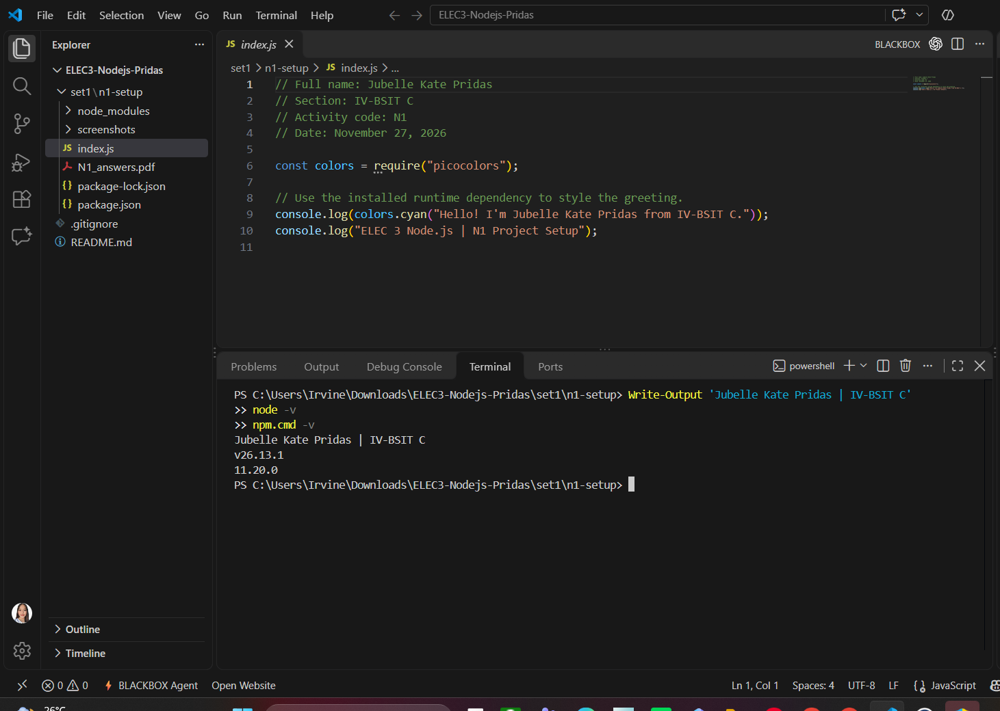
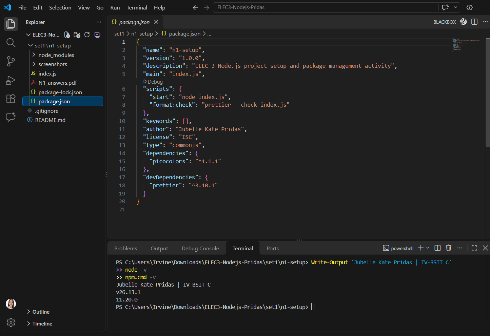
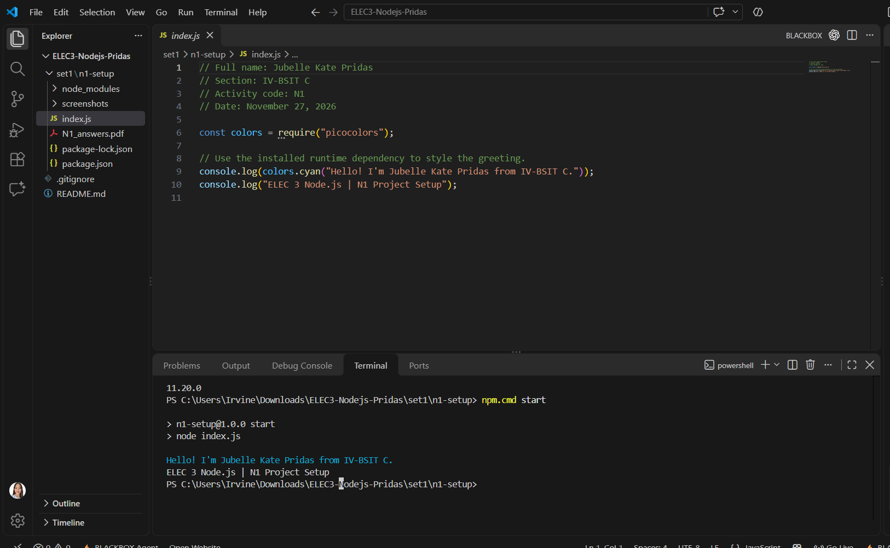
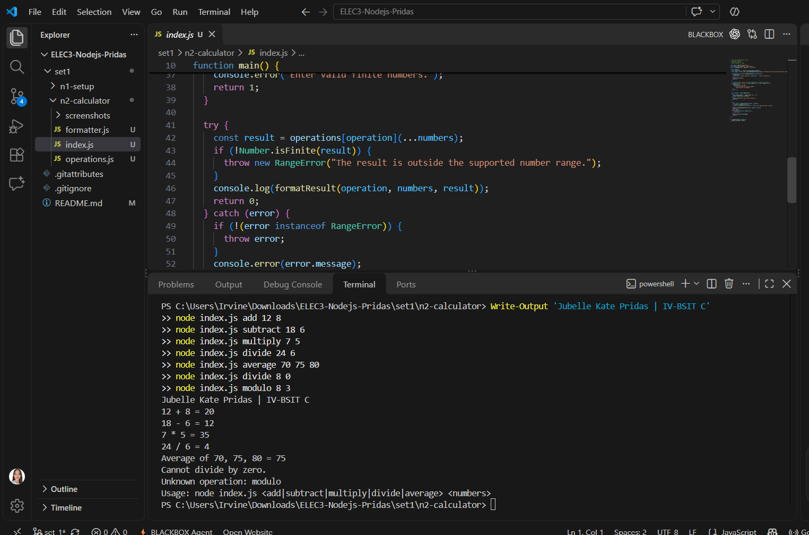

# ELEC 3 - Node.js

- **Student:** Jubelle Kate Pridas
- **Section:** IV-BSIT C

## Set 1

| Activity | Description |
| --- | --- |
| [N1 - Project Setup and Package Management](set1/n1-setup/) | Set up an npm project, install dependencies, and start the program with an npm script. |
| [N2 - Modular Calculator](set1/n2-calculator/) | Run arithmetic operations from the command line using CommonJS modules. |
| [N3 - File Manager](set1/n3-file-manager/) | Create, read, append, delete, and list text files. |

### N1 - Run from the repository root

```powershell
Set-Location set1/n1-setup
npm install
npm start
```

[Written answers](set1/n1-setup/N1_answers.pdf)






### N2 - Run from the repository root

```powershell
node set1/n2-calculator/index.js add 12 8
```



### N3 - Run from the repository root

```powershell
node set1/n3-file-manager/index.js list
node set1/n3-file-manager/index.js read notes.txt
```
